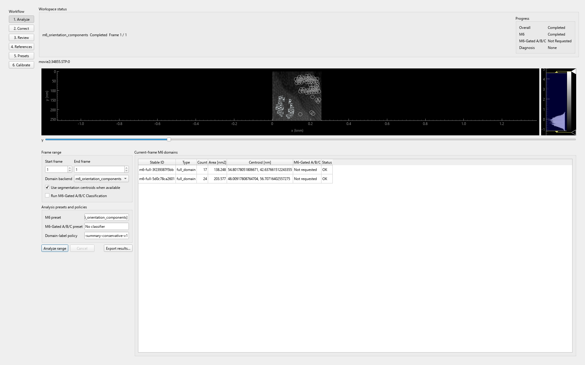
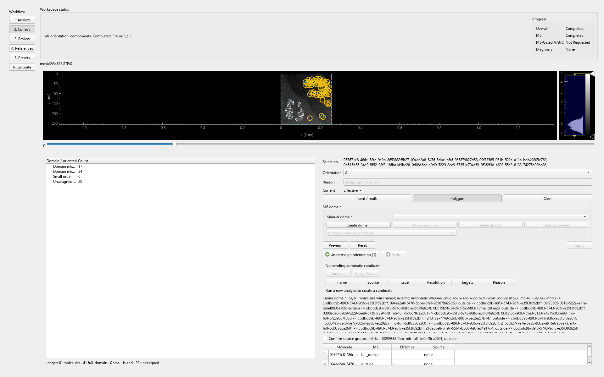
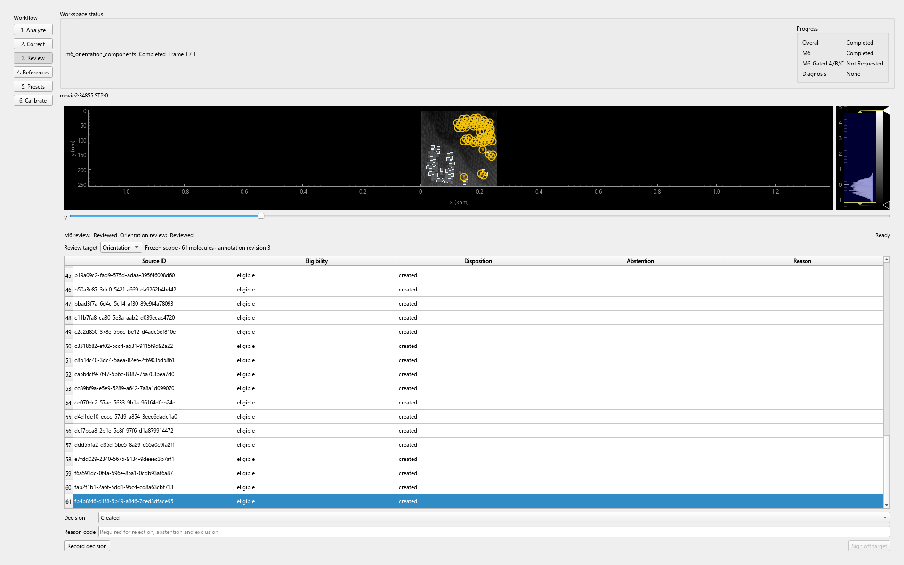
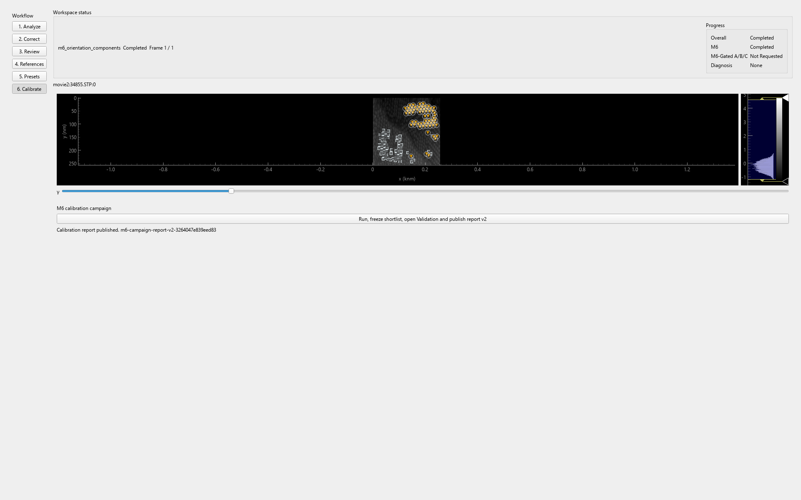

# Domain Analysis — instrukcja użytkownika

**Status:** wydana z MolTrack 0.1.0; zweryfikowana 2026-08-15

**Interfejs:** C — Spatial Command Center

**Formaty produkcyjne:** MolTrack session v3, Domain Analysis state v2,
Domain Analysis export v10,
M6/Orientation Reference Dataset v2, campaign report v2

**Kanoniczne definicje:** [CONTEXT.md](CONTEXT.md)

**Problemy i migracje:**
[DOMAIN_ANALYSIS_MIGRATION_AND_TROUBLESHOOTING.md](DOMAIN_ANALYSIS_MIGRATION_AND_TROUBLESHOOTING.md)

## Model pracy wariantu C

Obraz jest stałym centrum pracy. Pionowy rail wybiera etap workflow: `Analyze`,
`Correct`, `Review`, `References`, `Presets` lub `Calibrate`. Dolny arkusz pokazuje
narzędzia i dane tylko dla bieżącego etapu. Zmiana etapu nie tworzy drugiej kopii
analizy — każdy widok pracuje nad jednym workspace.

Highlight służy do oglądania wyniku, a selection do wskazania obiektów, które ma
objąć polecenie. Sam highlight nigdy nie modyfikuje danych.

## Quick start: pierwsza bezpiecznie reviewowana klatka

1. Otwórz serię i upewnij się, że klatka ma źródłowe molekuły lub segmentacje
   wymagane przez wybrany backend domen.
2. W panelu bocznym `Domain Analysis` kliknij `Domain Analysis...` i wybierz etap
   `Analyze`.
3. Wybierz backend oraz preset M6, ustaw zakres obejmujący jedną klatkę i uruchom
   `Analyze range`. Poczekaj na stan zakończony; nie uznawaj wyniku częściowego
   za review.
4. Przejdź do `Correct`. Kliknięcie w canvas lub wiersz tabeli ma wskazywać ten sam
   obiekt. Wybierz dokładnie jedną oś edycji: `M6 membership` albo `Orientation`.
5. Zaznacz molekuły punktem lub polygonem. Otwórz `Preview`, przeczytaj skutki,
   ostrzeżenia QC i konflikty. `Apply` zatwierdź dopiero po sprawdzeniu liczby
   zmienianych molekuł i docelowej wartości.
6. Jeżeli wynik jest błędny, użyj `Undo`; `Redo` ponawia dokładnie ten sam atom
   historii. Nie naprawiaj wyniku przez destrukcyjne nadpisanie automatu.
7. Przejdź do `Review`. Zakończ osobno review `M6` i `Orientation`. Dla wyniku,
   którego nie da się rozstrzygnąć, wybierz `Unresolvable` i podaj reason. Następnie
   wykonaj sign-off dla obu osi.
8. Przejdź do `References`, użyj `Save session`, a następnie `Open session`.
   Sesja v3 zachowuje automat, historię korekt, review i efektywny checkpoint.
   Sprawdź po otwarciu status obu review.

Ten sam Quick start jest dostępny z `Help > Domain Analysis Guide`.

**Dowód akceptacji:**

- wersja aplikacji: `0.1.0`;
- dane: rzeczywiste pliki TTMAPP `movie2/34855.STP` i `movie3/34172.STP`
  z zamrożonym manifestem detekcji;
- data: `2026-08-15`;
- wynik: `passed` dla deterministycznego clean-session walkthrough, obu
  backendów, Save/Open v3, exportu v10, obu Reference Dataset v2 i campaign
  report v2;
- Help: test Qt potwierdza `Help > Domain Analysis Guide`;
- manifest: [domain_analysis_documentation_release.json](../domain_analysis_documentation_release.json),
  bazujący na [dowodzie hard cutover TTMAPP](../domain_analysis_ttmapp_release_validation.json).

## Analyze

1. Wybierz zakres klatek, backend domen i preset M6.
2. Sprawdź wymagane capabilities. Brak źródłowych danych ma wyłączyć start i
   podać konkretny powód, a nie zakończyć się pustym wynikiem.
3. Uruchom analizę. Wynik automatyczny pozostaje niemutowalną bazą dla korekt.
4. Sprawdź status per klatka i lejek diagnostyczny. Późniejsza bramka nie może
   usuwać wcześniejszego raw evidence.
5. Ponowne przeliczenie tworzy oczekującego kandydata. Nie zastępuje automatu ani
   korekt bez jawnego rebase.

*Rysunek 1 — Analyze po zakończonym przebiegu TTMAPP na backendzie m6_orientation_components.*

## Correct: wybór, highlight i ręczne korekty

### Zaznaczanie

- Kliknięcie wybiera pojedynczą molekułę.
- Polygon wybiera zamrożony zestaw `source_id`; przesunięcie widoku po preview nie
  może zmienić zbioru objętego Apply.
- Wiersz hierarchii i obiekt na canvasie współdzielą selection oraz highlight.
- Filtr lub highlight nie zmieniają membership ani orientation.

### Oś M6

Wybierz jedną operację: utworzenie domeny, dodanie lub usunięcie członkostwa albo
przeniesienie do innej domeny. Ręczna domena otrzymuje stabilny UUID. Progi presetu
mogą wystawić ostrzeżenie QC, ale nie blokują ręcznej decyzji.

### Oś Orientation A–Z

Nadaj jedną klasę z series-wide katalogu A–Z albo `Unresolvable`. Ta decyzja jest
niezależna od osi M6. Dla `Unresolvable` reason jest obowiązkowy. Korekta zachowuje
automatyczną etykietę, confidence i evidence jako provenance.

### Preview i Apply

Preview musi pokazać:

- liczbę i identyfikatory objętych molekuł;
- wybraną oś, wartość przed i po oraz zmianę kompozycji domeny;
- konflikty blokujące, skutki high-impact wymagające potwierdzenia i informacje;
- fingerprint automatu, wobec którego utworzono polecenie.

`Apply` jest atomowy: albo zapisuje całą komendę, albo nie zapisuje nic. Gdy
konflikt blokuje operację, usuń przyczynę lub zmień selection i ponów Preview.

*Rysunek 2 — Correct z zamrożonym polygon selection, preview domeny i wymaganym potwierdzeniem batcha.*

### Undo i Redo

Undo i Redo dopisują odwracalne zdarzenia historii; nie kasują wcześniejszej
komendy. Po nowym Apply redo nie może odtworzyć nieaktualnej gałęzi. Zawsze
sprawdź efektywny wynik i status review po cofnięciu.

## Rebase po ponownym przeliczeniu

Nowy wynik automatyczny jest kandydatem, dopóki operator nie uruchomi jawnego
rebase. Preview rebase porównuje fingerprinty, geometrię i wszystkie `source_id`.
Brakujące źródło, zmiana geometrii oraz split/merge pozostają konfliktami. Nie
akceptuj automatycznej, częściowej migracji korekt.

Po Apply rebase stary automat i historia pozostają audytowalne, a nowe korekty
odnoszą się do zaakceptowanej bazy.

## Review

Review M6 i Orientation są oddzielne. Każda oś obejmuje cały zamrożony zakres i
wymaga jawnej decyzji dla każdego elementu. Sign-off zachowuje timestamp i fingerprint
podpisanego stanu; nie zapisuje `reviewer_id`. Gotowość zbioru danych jest wyliczana
z kompletności.

Zmiana efektywnego wyniku po sign-off oznacza odpowiedni scope jako stale i wymaga
ponownego review. Jedna zakończona oś nie maskuje braków drugiej.

*Rysunek 3 — Review po niezależnym sign-off M6 i Orientation; status targetu jest Ready.*

## Save, Open i export

- `Save State` ma zachować automat, append-only correction history, oba review,
  aktywne ustawienia oraz correction-aware checkpoint.
- `Open State` ma odtworzyć dokładnie ten sam efektywny wynik albo jawnie
  poddać niezgodne dane kwarantannie.
- Legacy export v9 jest formatem automatic-only i nie może udawać, że zawiera korekty.
- Produkcyjny export v10 zawiera warstwy automatic, correction, review, effective i
  per-point diagnostics. Szczegóły plików są w
  [referencji formatów](DOMAIN_ANALYSIS_FORMATS.md).

Po każdym ważnym review wykonaj cykl Save → Open → porównanie statusów przed
publikacją danych referencyjnych.

## References

Publikuj M6 Reference Dataset i Orientation Reference Dataset osobno. Oba używają
wieloplikowego envelope, ale mają różne cele, decyzje i metryki.

1. Wybierz kompletnie reviewowane measurement groups.
2. Zamroź source revision oraz podział całych grup na Calibration i Validation.
3. Uruchom kontrole leakage i source drift.
4. Sprawdź kompletność właściwej osi i opublikuj niemutowalną wersję.

Validation epoch wolno zużyć tylko raz w przewidzianej kampanii. Publikacja
referencji orientacji nie oznacza trenowania nowego klasyfikatora A–Z.

## Presets

Preset M6 jest edytowalnym zestawem ustawień. Preset wbudowany jest tylko do
odczytu; skopiuj go przed zmianą. Jeden preset może być aktywnym defaultem dla
przyszłych analiz. Uruchomiona analiza zamraża dokładną konfigurację i fingerprint,
więc późniejsza edycja presetu nie zmienia istniejącego wyniku.

Zapis lub aktywacja presetu nie oznaczają walidacji naukowej.

## Calibrate

Kampania M6 najpierw porównuje politykę geometrii first-shell na Calibration.
Następnie odrzuca kandydatów niespełniających ograniczeń precision/stability i
wybiera shortlistę według celu obejmującego recall oraz kary split/merge. Dopiero
zatwierdzony kandydat może zostać oceniony na jednorazowym Validation epoch.

Raport musi porównywać oba jawnie nazwane backendy na tych samych referencjach.
Nie wolno wybrać backendu domyślnego na podstawie różnych zbiorów lub wielokrotnego
podglądania Validation.

*Rysunek 4 — Calibrate po zamrożeniu shortlisty, jednorazowym Validation i publikacji campaign report v2.*
