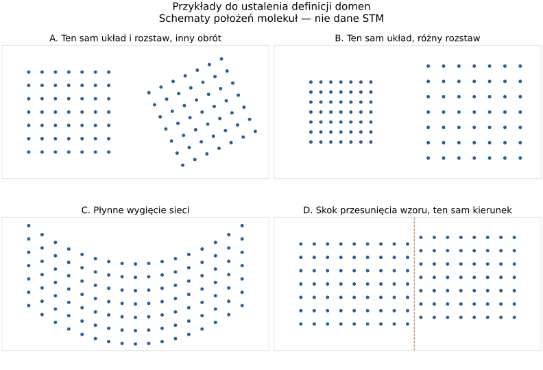

# Jak definiujemy wyspę, typ uporządkowania i domenę sieci?

ID: 02
Type: grilling
Labels: wayfinder:grilling
Mode: HITL
Status: resolved
Assignee: Codex — domains/order-types-contract
Parent: [STM Domains — etap 2: metody i zapis wyników](../map-methods-and-save.md)
Blocked by:

## Question

Jak oddzielić pokrycie materiałem i jego spójne wyspy od domen orientacji
i uporządkowania sieci molekuł na danej klatce?

Rozróżnienie typu od konkretnego obszaru i brak historii domen w czasie są już
ustalonym zakresem. Potrzebne są teraz kryteria na konkretnych przykładach:

- jedna wyspa z kilkoma orientacjami sieci i oddzielne wyspy o tym samym typie;
- podobne kierunki sieci przy różnym rozstawie, symetrii lub stopniu uporządkowania;
- ten sam wzór obrócony względem obrazu, stopniowy gradient orientacji, przesunięcie
  fazy układu oraz przerwa rozdzielająca dwa obszary;
- minimalna spójność obszaru i sposób traktowania defektów, małych skupień,
  brzegów obrazu oraz przerw w oznaczeniach;
- rozróżnienie braku wykrytego porządku, nowego typu, niepewnego wyniku i zbyt
  słabego sygnału, bez wymuszania wspólnej kategorii.

Jaką rolę w typie mają geometria położeń, orientacja sieci i periodyczność
widoczna w obrazie? Rozstrzygnięciem są definicje i przykłady graniczne,
nie wybór algorytmu. Pomiar kierunku pojedynczej molekuły jest odłożony
i nie jest warunkiem zdefiniowania tych dwóch warstw wyniku.

Kontekst: [słownik](../GLOSSARY.md),
[rozdzielenie wielkości w przeglądzie metod](../research-general-domain-detection.md).

## Discussion — 2026-10-19

Użytkownik wskazał to pytanie do wykonania przed odbiorem szkieletu. Podejmujemy
wcześniej tę decyzję definicyjną z etapu 2; nie oznacza to odbioru etapu 1 ani
rozpoczęcia implementacji metod. Rozstrzygnięcie wynika z trzech rund odpowiedzi
użytkownika; wyniki zapisano poniżej w `Answer`.

### Pierwsza runda — potwierdzona przez użytkownika

1. Czy wyspa jest całym zwartym płatem warstwy z normalnymi odstępami między
   molekułami, czy powierzchnią samych molekuł? Rekomendacja: płat warstwy;
   większe odsłonięte obszary podłoża pozostają poza wyspą.
2. Czy obrót tego samego układu i rozstawu daje ten sam typ o innej orientacji,
   czy inny typ? Rekomendacja: rozdzielić typ struktury i orientację sieci.
3. Czy pojedyncze defekty mogą pozostawać wewnątrz domeny? Rekomendacja: tak;
   wyraźna przerwa lub pas nieuporządkowany mogą ją rozdzielić. Konkretne
   tolerancje trzeba ustalić na danych.

Użytkownik przyjął wszystkie trzy rekomendacje. Zaktualizowano odpowiednie
pojęcia w słowniku; pozostałe rozstrzygnięcia nadal wymagają rozmowy.

### Druga runda — odpowiedzi użytkownika

- Istotny, powtarzalny inny rozstaw jako odrębny typ, przy porównywalnej skali
  obrazu; małe odkształcenia pozostają w tym samym typie.
- Użytkownik nie przewiduje płynnego wygięcia sieci; oczekuje raczej pasa bez
  uporządkowania i przejścia w inną orientację. To pas rozdziela domeny.
  Przykład C nie stanowi wymagania pierwszych prób metod.
- Wyraźna linia niedopasowania między przesuniętymi wzorami jako granica dwóch
  domen tego samego typu i orientacji; przesunięcie całego obszaru nie tworzy granicy.

Użytkownik potwierdził rozróżnianie typów przez istotny rozstaw i podział przez
wyraźną linię niedopasowania. Drobne odkształcenia nie tworzą automatycznie typu;
progi pozostają do ustalenia na danych.

### Trzecia runda — potwierdzona przez użytkownika

- Oddzielne stany: brak wykrytego porządku przy wystarczających danych,
  uporządkowany obszar bez rozpoznanego typu, niejednoznaczność i brak danych.
- Zbyt małe skupisko pozostaje widoczne jako materiał, lecz nie jest automatycznie
  rozpoznaną domeną; minimalne wymagania wiarygodności ustalamy podczas prób.
- Domena na brzegu jest uwzględniona w widocznym zakresie i oznaczona jako ucięta,
  bez odgadywania zasięgu lub połączeń poza kadrem.

Użytkownik przyjął wszystkie trzy rekomendacje.

## Answer — 2026-10-19

Uzgodniono definicje do oceny metod. Nie wybrano algorytmu ani nie potwierdzono
skuteczności istniejącego rozwiązania MolTrack. Podstawą są odpowiedzi użytkownika
z trzech rund powyżej oraz rozróżnienia zapisane w [słowniku](../GLOSSARY.md).

### Wyspa, typ i domena

**Pokrycie** opisuje płaty warstwy molekularnej na poprawnym polu pomiarowym.
Obejmuje normalne odstępy między sąsiednimi molekułami, lecz wyklucza większe
odsłonięte obszary podłoża. **Wyspa** to spójny płat tego pokrycia. Obszar wyspy
nie jest sumą bboxów ani masek molekuł. Większy otwór w otaczającej go warstwie
może pozostawać wyłączonym fragmentem wewnątrz jednej spójnej wyspy; dopiero
przerwa rozcinająca płat rozdziela wyspy.

**Typ uporządkowania** określa strukturę rozmieszczenia: układ, symetrię oraz
charakterystyczny rozstaw. Sam obrót albo jednolite przesunięcie nie zmienia
typu. Wyraźnie inny, powtarzalny rozstaw lub inna geometria sieci mogą oznaczać
inny typ; małe odkształcenia i defekty nie tworzą automatycznie nowych typów.
Typ zachowuje znaczenie w całej analizowanej serii. Ustalenie sposobu tworzenia
i nazywania wspólnego katalogu pozostaje częścią prób metod.

**Domena sieci** jest konkretnym spójnym obszarem uporządkowania na jednej klatce.
Jedna wyspa może zawierać kilka domen oraz materiał bez wykrytego porządku.
Oddzielne wyspy nie są jedną domeną, nawet gdy ich struktura jest taka sama.
Domeny mogą mieć ten sam typ, a także ten sam typ i orientację, jeśli rozdziela
je rzeczywista granica niedopasowania. Nie przypisujemy domenom trwałej
tożsamości między klatkami.

### Przykłady graniczne

| Obserwacja | Uzgodnione znaczenie |
| --- | --- |
| Dwa rozłączne płaty z takim samym układem | Dwie wyspy i oddzielne domeny; ten sam typ może występować w obu. |
| Ta sama struktura i rozstaw, inny obrót | Ten sam typ, różne orientacje i domeny. Same kąty nie określają liczby wysp. |
| Jedna warstwa, dwa kierunki rozdzielone pasem bez uporządkowania | Jedna wyspa, dwie domeny; pas nadal należy do materiału, lecz nie do uporządkowanych części. |
| Odsłonięta przerwa rzeczywiście rozcina płat | Rozdzielone wyspy i domeny; brak oznaczeń sam nie dowodzi takiej przerwy. |
| Normalne odstępy między sąsiednimi molekułami | Wchodzą w obszar płata; wyspa nie jest sumą masek pojedynczych molekuł. |
| Podobny kształt sieci, wyraźnie inny stabilny rozstaw | Inny typ przy porównywalnej skali; tolerancję trzeba wyznaczyć na danych. |
| Pojedynczy defekt lub drobne odkształcenie | Nie wymusza nowego typu ani podziału domeny. |
| Ta sama orientacja i rozstaw, wyraźna linia niedopasowania | Dwie domeny tego samego typu i orientacji. |
| Jednolite przesunięcie całego wzoru | Samo nie zmienia typu ani nie tworzy wewnętrznej granicy domeny. |
| Płynne wygięcie sieci, schemat C | Użytkownik nie oczekuje tego scenariusza; nie jest kryterium pierwszych prób. Nie uzgodniono ogólnej reguły jego podziału. |
| Zbyt małe skupisko do wiarygodnej oceny | Pozostaje w pokryciu, jeśli materiał jest widoczny; brak danych o porządku, bez automatycznego przypisania domeny. |
| Wiarygodnie rozpoznana domena na brzegu | Widoczny fragment zostaje uwzględniony i oznaczony jako ucięty; rozmiar i połączenia poza kadrem pozostają nieznane. |

### Dowody i rozpoznawanie typu

Typ opisuje strukturę rozmieszczenia: geometrię sąsiedztwa, symetrię i
charakterystyczny rozstaw. Orientacja sieci jest odrębną cechą. Periodyczność
widoczna w obrazie oraz położenia oznaczeń mogą dostarczać dowodów dotyczących
tej samej struktury; wybór metody łączenia tych dowodów należy do prób metod.
Wygląd jednej molekuły, gamma i kontrast obrazu same nie definiują nowego typu.

Nie zakładamy katalogu A/B/C ani symetrii M6. Obroty równoważne dla ustalonej
symetrii nie oznaczają różnych orientacji; okres porównania nie jest z góry
ustawiony na 60°. Zmiana skali obrazu lub niewiarygodna kalibracja nie jest
dowodem zmiany rozstawu struktury. Jednostki i dostępność kalibracji wynikają
z [kontraktu importu](01-import-and-geometry.md).

Mniejszy stopień regularności obniża pewność rozpoznania lub prowadzi do stanu
braku wykrytego porządku; sam nie oznacza nowego typu struktury. Wyraźnie
regularny wzór niepasujący do znanych typów pozostaje rozpoznanym
uporządkowaniem bez przypisanego typu — kandydatem do rozszerzenia katalogu.
Nie jest automatycznie nową fazą materiału ani kolejną dowolną etykietą klastra.

Brak oznaczenia pojedynczej molekuły, ubytek detekcji lub niski kontrast nie są
same w sobie dowodem przerwy, nieporządku ani granicy. Dowody z obrazu i położeń
mogą być niekompletne niezależnie. Konflikt tych dowodów ma prowadzić do jawnej
niepewności, zamiast wymuszać podział lub scalenie. Oparcie wyniku na obrazie
nie tworzy brakujących oznaczeń molekuł do późniejszych statystyk liczebności.

### Spójność, defekty i brzeg

O spójności decyduje obserwowany płat materiału i ciągłość uporządkowanego wzoru,
nie sam fakt połączenia punktów arbitralną krawędzią grafu. Pojedynczy defekt,
normalne odstępy i drobne zaburzenia mogą pozostawać wewnątrz domeny. Większa
odsłonięta przerwa, pas bez uporządkowania lub wyraźna linia niedopasowania
rozdzielają obszary zgodnie z tabelą. Nie mostkujemy nieobserwowanego obszaru
tylko dlatego, że po obu stronach występuje ten sam typ i orientacja.

Oczekiwanym przejściem między orientacjami jest pas bez uporządkowania.
Płynny gradient nie ma teraz osobnej uzgodnionej reguły ani obowiązkowego testu
odbioru. Gdy taki przypadek pojawi się na danych, trzeba wrócić do definicji;
nie wolno automatycznie nazywać go nieporządkiem tylko z powodu różnicy kątów.

Zbyt małe skupisko nie znika z pokrycia, ale wymaga statusu niewystarczających
danych o porządku. Minimalna liczba wiarygodnych położeń lub powtórzeń obrazu
zależy od metody i musi zostać wyznaczona w próbach, bez arbitralnego progu teraz.
Brzeg nie dyskwalifikuje domeny: raportujemy obserwowaną część i ucięcie.
Fragment zbyt mały do oceny nadal ma brak danych; niepewne połączenia poza
kadrem pozostają nieznane. Padding po rejestracji nigdy nie jest materiałem,
luką w warstwie ani obszarem braku uporządkowania.

### Stany wyniku

Te rozróżnienia opisują dostępność i znaczenie wyniku, nie kolejne typy sieci.
Mogą dotyczyć różnych cech: np. porządek może być pewny przy nieznanym typie
albo niejednoznacznej granicy. Nie wymagają jednego płaskiego wyliczenia w kodzie.

| Stan | Znaczenie |
| --- | --- |
| Rozpoznane uporządkowanie i typ | Dane uzasadniają porządek i przypisanie do znanej struktury; granice i orientacja mają własną ocenę wiarygodności. |
| Brak wykrytego porządku | Dostępne dane wystarczają do oceny, lecz nie potwierdzają badanej regularności. Nie oznacza braku materiału. |
| Uporządkowanie bez rozpoznanego typu | Regularność jest widoczna, ale wzór nie pasuje do ustalonych typów; kandydat na nowy typ, bez wymuszonej etykiety. |
| Wynik niejednoznaczny | Istnieją konkurencyjne interpretacje typu, orientacji lub granicy; zachowujemy tę niepewność. |
| Niewystarczające dane | Ocena niemożliwa lub niewiarygodna z powodu np. słabego sygnału, braków oznaczeń albo zbyt małego obszaru. To nie dowód nieporządku. |

Rozpoznanie domeny i rozpoznanie jej typu to odrębne kwestie: wiarygodnie
uporządkowany obszar może mieć granicę domeny bez przypisania do znanego typu.
Natomiast sama obecność małego skupiska materiału nie dowodzi domeny sieci.

### Przekazanie do referencji, prób i statystyk

- [Referencje i jakość](04-reference-and-quality.md) obejmą osobno pokrycie,
  granice domen, typy i orientację oraz jawne przypadki braku lub niepewności
  wyniku. Tabela przykładów jest zestawem przypadków do oznaczenia i sprawdzenia,
  nie deklaracją ich obecności lub poprawnej detekcji w TTMAPP.
- [Próby metod](05-stable-types-across-frames.md) mają sprawdzić także granicę
  niedopasowania przy jednakowym typie i orientacji. Sama zgodność kąta i rozstawu
  po obu stronach nie wystarcza do spełnienia całej definicji domeny.
- Progi odchylenia kąta/rozstawu, skala rozpoznawania przerw, minimalna wielkość,
  kryteria jakości i tolerancja granic muszą być uzasadnione referencjami i próbami.
  Ich brak liczbowy teraz nie uprawnia do arbitralnego uznania algorytmu za trafny.
- [Statystyki](06-frame-statistics.md) ustalą dokładne mianowniki, przypisanie
  molekuł i liczenie fragmentów. Muszą zachować różnicę między wyspą a domeną,
  obszarem warstwy a sumą masek molekuł, zerem a brakiem pomiaru oraz widoczną
  częścią domeny a jej nieznanym pełnym rozmiarem.

Wykonano analizę istniejącej dokumentacji i kodu oraz schematy do rozmowy.
Nie uruchamiano algorytmów ani testów ich jakości, nie zmieniano kodu aplikacji.
Odbiór szkieletu pozostaje warunkiem rozpoczęcia prób metod etapu 2.

### Materiał do rozmowy

Schematy pokazują położenia punktów, nie konkretne dane STM. Przykładowa sieć
kwadratowa nie jest założeniem o symetrii TTMAPP. Linia w przykładzie D wskazuje
miejsce skoku przesunięcia wzoru, nie zatwierdzoną granicę domeny. Nazwy A–D
oznaczają przykłady, nie klasy uporządkowania.

Sprawdzenie istniejącego kodu dostarczyło kontekstu, lecz nie rozstrzygnięcia:

- [Preset teksturowy](../../../moltrack/analysis/texture_domain_analysis.py)
  nazywa klasy Orientation A/B/C i porównuje histogramy kierunków gradientu
  obrazu. Nie stanowi to ogólnej definicji typu geometrii sieci.
- [Podobieństwo typów M6](../../../moltrack/analysis/m6_domain_type_similarity.py)
  porównuje orientację modulo 60° i długości wiązań. To inny kontrakt;
  nie przenosimy go automatycznie do STM Domains.
- [Rdzeń harmoniczny](../../../moltrack/analysis/_local_harmonic_bond_order.py)
  rozróżnia niedostateczne sąsiedztwo i niepoprawne pozycje od wyniku pomiaru.
  Braki oznaczeń same nie dowodzą pustej powierzchni ani nieporządku.
- [Przegląd metod](../research-general-domain-detection.md) już wskazuje
  gradient orientacji i przesunięcie fazy jako odrębne przypadki graniczne.
  Ustalenie ich znaczenia w programie należy do tego ticketu.
