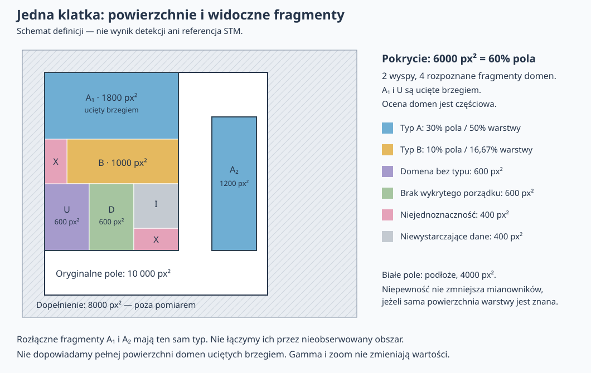

# Jak dokładnie liczymy ilości i udziały na każdej klatce?

ID: 06
Type: grilling
Labels: wayfinder:grilling
Mode: HITL
Status: resolved
Assignee: Codex — domains/frame-statistics
Parent: [STM Domains — etap 2: metody i zapis wyników](../map-methods-and-save.md)
Blocked by: 01, 02

## Question

Jak zdefiniować liczby molekuł według typu, powierzchnie, udziały oraz liczbę
oddzielnych domen, żeby wartości były jednoznaczne i porównywalne w serii?

Osobno zdefiniujmy pokrycie i wyspy oraz domeny sieci wewnątrz materiału.
Liczba wysp nie jest liczbą domen orientacyjnych. Ustalmy mianownik udziału
domen sieci: całe poprawne pole klatki, pokrycie lub obie jawnie nazwane miary.

Pole odniesienia jest już ustalone: oryginalny rozmiar każdej klatki przesunięty
według rejestracji. Dopełnienie większego obrazu nie wchodzi do statystyk.
Nie wracamy tu do wyboru stałego ROI.

Z [definicji wysp, typów i domen](02-order-types-and-domains.md#answer--2026-10-19)
wynika już, że wyspa obejmuje płat warstwy z normalnymi odstępami między
molekułami. Nie zastępujemy jego powierzchni sumą masek molekuł. Domeny ucięte
brzegiem uwzględniamy w widocznym zakresie i oznaczamy ucięcie; małe skupisko
bez wystarczających danych o porządku nie jest automatycznie domeną.

Pozostaje ustalić dokładne liczenie powierzchni odtworzonych obszarów,
mianowniki udziału powierzchni i liczebności, przypisywanie molekuł do domen
oraz agregację nakładania, niepewności i nieprzypisanych typów. Jak prezentujemy
liczby obserwowanych fragmentów bez wnioskowania o połączeniach poza kadrem?
Co pokazujemy w pikselach przy braku kalibracji i jak przechodzimy na jednostki
fizyczne po jej uzupełnieniu?

Jak przedstawiamy zmiany po numerach klatek przy niewiarygodnych czasach eksportu,
wybór zakresu klatek oraz rozróżnienie zera od braku pomiaru? Zmiana liczby obszarów
w klatkach nie jest dowodem narodzin lub zaniku konkretnej domeny.

Rozstrzygnięcie zawiera definicje wielkości, jednostki i przykłady obliczeń na
prostym układzie z domeną na brzegu, pustym dopełnieniem i niepewnymi wynikami.
Te statystyki powstają w etapie 2; ich definicja nie blokuje podstawowego podglądu.

## Dependencies

- [Jak zapis wejściowy odtwarza obrazy, oznaczenia i rejestrację?](01-import-and-geometry.md)
- [Jak definiujemy wyspę, typ uporządkowania i domenę sieci?](02-order-types-and-domains.md)

## Discussion — 2026-10-19

Na bezpośrednie polecenie użytkownika rozstrzygamy definicje statystyk
przed odbiorem szkieletu. To decyzja pojęciowa, nie implementacja ani walidacja
metod wykrywania. Kontrakty importu i definicje wysp/typów/domen są już
uzgodnione; pilotaż wskazał osobne pytania do dalszych prób metod.

### Pierwsza runda — odpowiedzi użytkownika

- Dwa jawnie nazwane udziały powierzchni typu: względem całego oryginalnego
  pola klatki i względem powierzchni warstwy. Dla pola 10 000 px², warstwy
  6 000 px² i typu A o powierzchni 3 000 px² są to odpowiednio 30% i 50%.
- Przypisanie molekuły według środka bieżącego bboxa; typ przejęty z domeny.
  Jedno oznaczenie liczone najwyżej raz. Środek w niepewnej granicy albo poza
  rozpoznanymi domenami pozostaje nieprzypisany; maska molekuły nie jest wymagana.

Obie rekomendacje przyjęte przez użytkownika. Pozostałe decyzje są w toku;
to nie jest jeszcze pełne rozstrzygnięcie statystyk.

### Druga runda — odpowiedzi użytkownika

- Mianownikiem udziału liczebności są wszystkie poprawne oznaczenia w polu
  klatki, również bez przypisanego typu. Nie normalizujemy do samych rozpoznanych
  typów: 40 oznaczeń typu A na 100 daje 40%.
- O włączeniu oznaczenia do statystyk decyduje środek bieżącego bboxa w oryginalnym
  polu klatki. Bbox może częściowo wychodzić poza pole; środek poza polem wyłącza
  oznaczenie z liczenia, ale nie usuwa go z wejścia ani podglądu.
- Dostępne wyniki pozostają widoczne jako częściowe, z informacją o brakach
  i niejednoznacznościach. Liczba rozpoznanych fragmentów przy niepełnej ocenie
  nie udaje pełnej liczby domen w klatce.

Użytkownik przyjął wszystkie trzy rekomendacje.

### Trzecia runda — odpowiedzi użytkownika

- Pierwszy zakres statystyk to tabela i wykres osobno dla klatek, bez średnich
  i sum serii. Brak pomiaru pozostaje przerwą, nie zerem.
- Nierozstrzygnięte nakładanie propozycji domen pozostaje niejednoznaczne;
  wspólna część nie jest liczona podwójnie ani arbitralnie przyznawana domenie.
  Jeśli pokrycie jest pewne, nadal należy do powierzchni warstwy. Użytkownik
  dodatkowo poprosił o możliwość wyboru; zakres ręcznego rozstrzygnięcia jest
  doprecyzowywany osobnym pytaniem.

### Doprecyzowanie ręcznego wyboru — potwierdzone przez użytkownika

Wybór dotyczy konkretnego konfliktu. Użytkownik może przyznać wspólny obszar
jednej z proponowanych domen albo pozostawić niejednoznaczność. Program
oznacza korektę użytkownika i przelicza powierzchnie oraz przypisania molekuł.
Nie chodzi o globalną regułę automatycznego wyboru „pewniejszej” domeny.

### Kontekst istniejącego kodu — audyt tylko do odczytu

Istniejące miary MolTrack nie rozstrzygają definicji STM Domains:

- [Geometria eksportu Domain Analysis](../../../moltrack/analysis/domain_analysis/canonical_geometry.py)
  buduje obszar analizowany jako unię masek molekuł lub zastępczych ramek;
  [moduł statystyk](../../../moltrack/analysis/domain_analysis/module.py) sumuje
  ich piksele dla domen. To nie powierzchnia płata warstwy z normalnymi odstępami.
- [Starszy footprint orientacyjny](../../../moltrack/analysis/orientation_domain_footprint.py)
  korzysta z obciętych komórek Voronoia i promienia wsparcia. To inny wariant,
  który również wymaga osobnej oceny jako rekonstrukcja pokrycia.
- [Agregaty orientacyjne](../../../moltrack/analysis/orientation_domain_frame_aggregates.py)
  mają jawne mianowniki i niezdefiniowane udziały przy pustym mianowniku, ale
  zbiorcze `unassigned` nie zachowuje wszystkich uzgodnionych stanów niepewności.
- [Agregacja zakresu M6](../../../moltrack/analysis/m6_range_analysis.py)
  zachowuje brakujące miejsca klatek i liczy średnie klatek. Nie jest to jeszcze
  decyzja o podsumowaniu zakresu w STM Domains.
- [Geometria Domain Analysis](../../../moltrack/analysis/domain_analysis/geometry.py)
  wymaga dodatniej skali fizycznej; dla TTMAPP potrzebny pozostaje tryb px²
  zgodnie z kontraktem importu. Mianowniki odnosimy do oryginalnego pola,
  nie do unii oznaczeń ani powiększonego płótna.

Nie zmieniano ani nie uruchamiano tych metod. Audyt służy uniknięciu
automatycznego przeniesienia miar o odmiennym znaczeniu.

## Answer — 2026-10-19

Uzgodniono definicje statystyk na podstawie odpowiedzi powyżej. Wyniki są
osobne dla każdej klatki. Nie dodajemy w tym zakresie sum ani średnich serii,
śledzenia obiektów czy szacowania liczby niewykrytych molekuł.
To kontrakt do późniejszej implementacji; skuteczność metod pozostaje otwarta.

### Pole, jednostki i powierzchnia

Pole odniesienia `F_i` to oryginalne pole klatki o rozmiarze `W_i × H_i`,
przeniesione zgodnie z zapisaną rejestracją. Jego powierzchnia wynosi
`A_F,i = W_i × H_i px²`. Padding, zoom, gamma i wybór widoku nie zmieniają
pomiaru. Nie zastępujemy pola przecięciem wszystkich klatek, unią oznaczeń
ani zbiorem samych poprawnie sklasyfikowanych miejsc.

Powierzchnie wyznaczamy na jednej siatce oryginalnej klatki: każda komórka
przypisana do obszaru wnosi 1 px². Maski/etykiety mają tę siatkę; obszar podany
jako polygon wymaga jednego ustalonego odwzorowania według środków komórek.
Nie mieszamy w jednej tabeli pól analitycznych polygonów z liczbą pikseli masek.
Pomiar odnosi się do zachowanego wyniku, nie do kolejnych przekształceń podglądu.
Wynik wyrównany trzeba powiązać z polem oryginalnym; nieznana geometria oznacza
brak pomiaru. Ułamkowe przesunięcie lub NaN w interpolowanym podglądzie nie
zmniejszają pola odniesienia. Faktycznie nieoceniony obszar pozostaje brakiem
danych, a nie podłożem.

`P_i` jest obszarem warstwy w `F_i`, z normalnymi odstępami między molekułami.
`D_ij` jest rozpoznanym obserwowanym fragmentem domeny w tej warstwie.
Pole wyspy ani domeny nie jest sumą bboxów lub masek samych molekuł.
Powierzchnię typu `k` liczymy jako pole unii zaakceptowanych fragmentów tego
typu `T_ik`; każdy element powierzchni jest liczony najwyżej raz.
Obszary wysp są rozłączne, a fragmenty domen mieszczą się w pokryciu. Sprzeczny
wynik, np. domena na potwierdzonym podłożu, wymaga oznaczenia konfliktu, nie
cichego rozszerzania pokrycia. Same punkty grafu nie dostarczają powierzchni domen.

Bez wiarygodnej kalibracji jednostką jest **px²**, liczebności są całkowite,
a udziały w procentach. Przy potwierdzonej skali osi `s_x, s_y` w nm/px:
`A_nm² = A_px² × s_x × s_y`. Uwzględniamy różną skalę X/Y. Zmiana jednostki
nie zmienia udziałów, przypisań ani liczebności. Potwierdzenie kalibracji
określa kontrakt importu; ten ticket nie dodaje jej edytora. Zastępcze wartości
TTMAPP nie uprawniają do raportowania nm². Jeśli kalibracja ma wpływ na samą
klasyfikację struktur, jej zmiana wymaga osobnej oceny ważności analizy.

### Wielkości na każdej klatce

| Wielkość | Definicja |
| --- | --- |
| Powierzchnia pola | `A_F = W × H`; bez dopełnienia. |
| Powierzchnia warstwy | `A_P = A(P)`; unia wysp, bez podwójnego liczenia. |
| Pokrycie pola | `100 × A_P / A_F`. |
| Powierzchnia typu k | `A_k = A(T_k)`; suma rozłącznych części tego typu. |
| Udział powierzchni typu w polu | `100 × A_k / A_F`. |
| Udział powierzchni typu w pokryciu | `100 × A_k / A_P`, gdy `A_P > 0` i mianownik jest znany. |
| Liczba wysp | Liczba rozpoznanych, przestrzennie spójnych płatów w polu. |
| Liczba fragmentów domen | Liczba rozpoznanych obserwowanych fragmentów, ogółem i według typu; domeny bez typu osobno. |
| Liczba oznaczonych molekuł | `N`: liczba poprawnych, odrębnych oznaczeń ze środkiem w polu. |
| Liczba oznaczonych molekuł typu k | `N_k`: oznaczenia przypisane do domen typu k. |
| Udział liczebności typu k | `100 × N_k / N`, gdy `N > 0`. |

Typ i orientacja pozostają rozdzielone: różne orientacje tego samego typu
sumują się w jednym wierszu typu. Orientacja sama nie tworzy nowej kategorii
liczebności. Nie dodajemy tu średniego kąta sieci ani orientacji molekuł.

Wyniki zachowują informacje o poszczególnych wyspach i fragmentach domen:
obserwowaną powierzchnię, typ lub jego brak, przypisane oznaczenia, ucięcie
brzegiem oraz dostępność/niepewność. Ucięte fragmenty są w ogólnej liczbie
i mają osobny znacznik/licznik. Nie ekstrapolujemy ich pełnego rozmiaru.
Dwa odłączone fragmenty tego samego typu liczymy osobno, także jeśli mogłyby
łączyć się poza kadrem. Zmiana liczby fragmentów między klatkami nie oznacza
narodzin lub zaniku konkretnej domeny.

Małe skupisko bez dostatecznych danych może być wyspą materiału, lecz nie
otrzymuje automatycznie fragmentu domeny. Rozpoznana domena bez znanego typu
wchodzi do liczby fragmentów ogółem i do osobnej pozycji „bez rozpoznanego typu”.
Niepewne propozycje podziału nie są doliczane jako pewne domeny.

### Przypisywanie i liczenie oznaczeń

Środek bieżącego bboxa to `((x1+x2)/2, (y1+y2)/2)`, po poprawnym przeniesieniu
do układu oryginalnego. Nie przycinamy bboxa przed wyznaczeniem środka.
Do `N` włączamy oznaczenie, gdy `0 ≤ x < W` i `0 ≤ y < H`. Częściowy bbox
ze środkiem w polu wnosi jedno oznaczenie; środek poza polem wyłącza z `N`,
z zachowaniem oznaczenia i powodu wyłączenia w podglądzie/diagnostyce.

Środek w jednoznacznie wyznaczonej domenie przypisuje całe oznaczenie do niej;
typ pochodzi z domeny. Nie dzielimy liczby molekuł proporcjonalnie do powierzchni
bboxa. Brak SAM nie zmienia reguły. Środek w domenie bez typu ma przynależność
do domeny, ale nie jest doliczany do żadnego znanego typu. Środek w spornym
obszarze lub poza rozpoznanymi domenami pozostaje bez przypisania do domeny.
Przy dokładnie spornym położeniu na granicy nie rozstrzygamy remisu po ID.

Jedna tożsamość oznaczenia na klatce jest liczona najwyżej raz. Powiązana maska
i bbox nie są dwiema molekułami. Sprzeczne duplikaty ID wymagają walidacji
wejścia; nie wybieramy arbitralnie jednego położenia. Nie łączymy różnych
oznaczeń wyłącznie dlatego, że ich bboxy się nakładają. `selected=false`
ani samo niskie confidence nie są cichym filtrem liczebności.
Wyłączenia błędnych/niedostępnych oznaczeń są jawne i poza mianownikiem `N`.

Statystyka opisuje **oznaczone molekuły**, nie pełną rzeczywistą populację.
Nie dopisujemy brakujących molekuł z gęstości, powierzchni lub FFT. Gdy obraz
pozwala ustalić domeny, lecz brak oznaczeń, powierzchnie mogą być dostępne,
a liczebność molekuł nadal nieznana. Liczba rekordów równa 0 przy braku zapisanych
oznaczeń nie jest potwierdzonym zerem fizycznych molekuł.

### Niepewność, konflikty i ręczna korekta

Nierozstrzygnięta wspólna część propozycji domen zostaje usunięta z ich
zaakceptowanych obszarów i oznaczona jako niejednoznaczna. Nie trafia podwójnie
do powierzchni ani liczebności. Dotyczy to także konfliktu granicy między
domenami tego samego typu: nie ukrywamy braku przypisania do domeny.
Wspólna część nadal należy do `P`, jeśli obecność materiału jest pewna.
Konflikt typu lub granicy nie dowodzi odsłoniętego podłoża.

Użytkownik może rozstrzygnąć **konkretny sporny obszar**, wskazując jedną
z proponowanych domen, albo zostawić niejednoznaczność. Po wyborze obszar
należy wyłącznie do wskazanej domeny; przeliczamy jej geometrię, fragmenty,
powierzchnie i przypisania środków oznaczeń. Pokrycie nie zmienia się, jeśli
spór dotyczył tylko podziału wewnątrz pewnego materiału. Korekta ma jawne
pochodzenie użytkownika; nie udaje wyniku algorytmu ani dowodu jego trafności.

To wybór spośród propozycji, nie pełny edytor granic ani tworzenie oznaczeń
molekuł. Przywrócenie stanu nierozstrzygniętego usuwa tę decyzję i przelicza
wynik. Korekta jest związana z konkretnym wynikiem, geometrią i katalogiem;
po ponownej analizie nie przenosimy jej automatycznie na nowy numer domeny.
Sposób zapisania i ponownego pokazania korekty ustali
[kontrakt zapisu](08-save-and-export.md).

Osobno zachowujemy: brak wykrytego porządku przy wystarczających danych,
uporządkowanie bez typu, niejednoznaczność oraz niewystarczające dane.
„Nieprzypisane” może być nagłówkiem zbiorczym, ale nie usuwa tych przyczyn.
Podłoże i oznaczenia poza rozpoznanymi domenami są odrębne od nieporządku.
Ta sama jednostka powierzchni/oznaczenie nie jest sumowana w kilku kategoriach;
przy kilku powodach niepewności zachowujemy je jako opis, bez podwójnego liczenia.

Pewny materiał o nieznanym typie lub porządku pozostaje w mianowniku `A_P`.
Nie normalizujemy udziałów do samych sklasyfikowanych fragmentów. Gdy samo
pokrycie jest częściowe, pokazujemy rozpoznaną powierzchnię materiału i jej
udział w polu jako **częściowe**; pełne `A_P` i udział typu w całej warstwie
pozostają niedostępne. Nie używamy powierzchni rozpoznanej części jako ukrytego
zamiennika pełnego mianownika. Dostępność dotyczy każdej miary osobno.

Wynik częściowy może zawierać np. 4 rozpoznane fragmenty, ale nie nazywamy
tego pełną liczbą domen ani dolnym ograniczeniem ich liczby poza kadrem.
Rozkład typów jest częściowy, jeśli pozostały nieocenione miejsca. Przy braku
jakiegokolwiek wiarygodnego rozpoznania danej wielkości pokazujemy „brak wyniku”,
nie wartość 0. Zakończona, wiarygodna ocena bez danego obiektu daje 0.

Gdy `A_P = 0` przy potwierdzonym pustym polu, pokrycie pola wynosi 0%,
powierzchnie domen i liczby fragmentów wynoszą 0, a udziały w warstwie są
niezdefiniowane. Gdy `N = 0`, udziały liczebności także są niezdefiniowane.
Brak obrazu/analizy, błąd lub anulowanie nie tworzą wiersza zer.

### Seria i prezentacja

Tabela i wykres zachowują wybrane klatki oraz ich tożsamość w serii źródłowej.
Brakujące wyniki pozostają w tabeli ze statusem i jako przerwy na wykresie;
nie usuwamy pozycji ani nie interpolujemy przez brak pomiaru. Wyniki częściowe
i skorygowane ręcznie są odróżnialne od kompletnych automatycznych wyników.

Dla TTMAPP oś stanowi numer klatki, zgodnie z kontraktem importu; nie używamy
zastępczych zer czasu ani szybkości odtwarzania jako czasu pomiarowego.
Wiarygodne czasy innych wejść można pokazać z jednostką i zachowaniem powiązania
z klatką. Nie dodajemy szybkości zmian wymagających czasu pomiarowego.

Wybór zakresu określa pokazywane/analizowane klatki, nie zmianę pola odniesienia.
Porównanie udziałów typu wymaga wspólnego katalogu. Zmiana jego zakresu lub
parametrów może wymagać nowej analizy; identyczny numer z dwóch katalogów nie
jest gwarancją tego samego typu. Samo filtrowanie tabeli gotowego wyniku nie
przelicza w tle katalogu. Nie sumujemy widocznych obiektów jako unikalnych
molekuł/domen w całej serii. Zbiorcze średnie i sumy są poza obecnym zakresem.

### Przykład rachunkowy

Schemat ma pole 100 × 100 px i płótno z dopełnieniem 150 × 120 px.
`A_F = 10 000 px²`, padding `8000 px²` jest wyłączony. Dwie wyspy mają
razem `A_P = 6000 px²`, więc pokrycie wynosi **60%**. Brak danych o porządku
nie zmniejsza tu pokrycia: na schemacie obecność materiału jest znana.

| Obszar | Powierzchnia [px²] | % pola | % warstwy |
| --- | ---: | ---: | ---: |
| Typ A: fragment A₁ 1800 i A₂ 1200 | 3000 | 30 | 50 |
| Typ B | 1000 | 10 | 16,67 |
| Rozpoznana domena bez typu U | 600 | 6 | 10 |
| Materiał bez wykrytego porządku | 600 | 6 | 10 |
| Niejednoznaczność | 400 | 4 | 6,67 |
| Niewystarczające dane o porządku | 400 | 4 | 6,67 |

Przed zaokrągleniem wiersze dają 6000 px², 60% pola i 100% warstwy.
Rozpoznano **4 fragmenty domen**, w tym 2 typu A, 1 typu B i 1 bez typu.
A₁ i U są ucięte brzegiem; oba są wliczone w obserwowanym zakresie.
Ocena domen jest częściowa, więc cztery fragmenty nie udają pełnej liczby domen.
Liczba wysp wynosi 2 i nie jest utożsamiona z liczbą domen.

Osobny przykładowy zestaw oznaczeń na takiej klatce ma `N = 100`: 40 w typie A,
15 w B, 10 w domenie bez typu, 10 w materiale bez wykrytego porządku,
10 w obszarze niejednoznacznym, 5 w obszarze bez danych i 10 poza rozpoznanymi
domenami. Udziały liczebności A/B to **40% / 15%**, a 45% nie ma znanego typu,
z zachowaniem przyczyn. To liczby ilustracyjne, nie detekcje ze schematu ani STM.

Nieprzycięty bbox `(-2, 8, 3, 12)` ma środek `(0,5; 10)` i jest wliczony.
Bbox `(-3, 18, 2, 22)` ma środek `(-0,5; 20)` i pozostaje poza `N`, mimo
częściowego wejścia w obraz. Rejestracja przenosi pole, domeny i środki razem,
więc te decyzje nie zmieniają się po przełączeniu widoku.

Przy hipotetycznie potwierdzonej skali `s_x = 0,2`, `s_y = 0,3 nm/px`
pole klatki miałoby 600 nm², warstwa 360 nm², a typ A 180 nm².
Udziały 60%, 30% i 50% pozostają takie same. To przykład konwersji, nie
kalibracja pliku TTMAPP.

Przykład konfliktu: propozycja A ma 1000 px², B 800 px², a część wspólna
200 px². Pewny materiał zajmuje **1600 px²**, nie 1800. Przed rozstrzygnięciem
A ma 800 px², B 600 px², a 200 px² jest niejednoznaczne. Po ręcznym przyznaniu
części wspólnej A: A ma 1000 px², B 600 px²; pokrycie pozostaje 1600 px².
Oznaczenia ze środkami w tych 200 px² przechodzą z nieprzypisanych do A.

### Przekazanie do implementacji i odbioru

- Wymagane przypadki obejmują zachowanie sum bez nakładania, oba mianowniki
  powierzchni, nieprzypisane oznaczenia w mianowniku liczebności, bbox na brzegu,
  brak/zero, częściowe pokrycie, domenę bez typu oraz ręczny wybór konfliktu.
- Wynik musi być niezmienny wobec zoomu, gamma i przełączenia raw/aligned;
  ułamkowe przesunięcie nie może dodawać pola dopełnienia do pomiaru.
- [Próby pokrycia](10-coverage-and-scale.md), [typów](11-structural-type-catalogue.md)
  i [granic](12-phase-boundaries.md) dostarczą geometrii i warunków wiarygodności.
  [Odbiór metod](13-method-acceptance.md) musi sprawdzić zgodność wyników z tymi
  definicjami; samo istnienie masek lub punktów grafu jej nie potwierdza.
- [Zapis wyników](08-save-and-export.md) ma zachować mianowniki, jednostki,
  dostępność, katalog, ucięcia i ręczne rozstrzygnięcia, bez mieszania korekt
  użytkownika z automatycznym wynikiem.

W tym zadaniu sprawdzono rachunki przykładu, schemat i spójność dokumentacji.
Nie implementowano obliczeń ani UI aplikacji i nie uruchamiano testów metod.
Nie ma jeszcze walidacji tych statystyk na rzeczywistych granicach TTMAPP.
