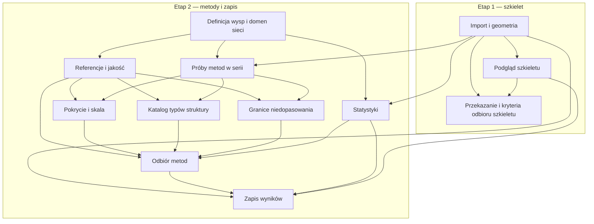

# Rejestr decyzji STM Domains

Aktualnie pracujemy nad [etapem 1: działającym szkieletem](../map.md).
[Etap 2: metody i zapis wyników](../map-methods-and-save.md) rozpoczyna się po
implementacji i odbiorze szkieletu. Otwarte decyzje etapu 2 nie blokują etapu 1.
Statusy i zależności przechowujemy w ticketach; indeks poniżej grupuje je według map.

Na bezpośrednie polecenie użytkownika z 2026-10-19 wcześniej podejmujemy
[definicje wyspy, typu i domeny sieci](02-order-types-and-domains.md) oraz
[pilotaż porównania metod](05-stable-types-across-frames.md). Pilotaż zakończono
wskazaniem luk; na polecenie użytkownika utworzono dalsze pytania o pokrycie,
typy, granice domen i odbiór metod. To jawne wyjątki dla wskazanych zadań,
bez deklaracji gotowego szkieletu lub zwalidowanego algorytmu.
Następnie na bezpośrednie polecenie użytkownika uzgodniono także
[definicje statystyk klatek](06-frame-statistics.md). Odbiór metod i zapis
wyników korzystają z tych definicji; sama decyzja nie implementuje statystyk.

## Wayfinding operations

Lokalny tracker Markdown znajduje się w wersjonowanym `docs/stmdomains/`, zgodnie
z instrukcjami repozytorium. Nie wymaga zewnętrznego trackera.

- **Mapa:** osobny plik z etykietą `wayfinder:map`. Domyślnie aktywna jest
  `../map.md`; do drugiej mapy przechodzimy po odbiorze szkieletu. Samo zamknięcie
  pytania o przekazanie do implementacji nie jest jeszcze odbiorem programu.
- **Pytanie:** jeden plik `NN-nazwa.md`. `ID` identyfikuje go w całym rejestrze,
  `Parent` wskazuje mapę, a tytuł służy do nazywania w rozmowie i linkach.
  Zachowujemy dotychczasowe ID i ścieżki również po zmianie zakresu.
- **Typ:** `Type` i odpowiadająca mu etykieta `wayfinder:<type>`; bez etykiet
  implementacyjnych. `Mode: HITL` wymaga rozmowy z użytkownikiem.
- **Status:** `open`, `claimed`, `resolved`; dodatkowo `closed` dla pytania
  usuniętego z zakresu. Zamknięcie zakresowe opisujemy pod `Scope disposition`;
  nie oznacza naukowego rozstrzygnięcia ani spełnienia zależności.
- **Frontier:** wybieramy wyłącznie dzieci aktywnej mapy z `Status: open`,
  pustym `Assignee` i wszystkimi zależnościami `resolved`. Pierwszeństwo ma
  kolejność numerów plików. Pytanie innej mapy nie trafia do tej kolejki.
- **Zależności:** `Blocked by` wskazuje istniejące ID, także innej mapy;
  `Dependencies` zawiera odpowiadające nazwane linki. Zmiana zależności wymaga
  aktualizacji diagramu. Otwarte pytanie nie może zależeć od zakresowo
  zamkniętego pytania; taką zależność trzeba usunąć lub zastąpić.
- **Claim:** przed pracą ustaw prowadzącego w `Assignee` i `Status: claimed`.
  Pytania przypisanego innej sesji nie podejmujemy równolegle.
- **Resolve:** dopisz datowany wynik pod `Answer`, ustaw `Status: resolved`
  i dodaj nazwany link z krótkim wynikiem do Decisions so far właściwej mapy.
  Zamknięcie zakresowe trafia do Out of scope, nie do Decisions so far.
- **Nowe pytania:** najpierw utwórz pliki, potem wpisz realne ID i zależności.
  Dopiero wtedy usuń odpowiadający obszar z Not yet specified mapy.
- **Praca:** grilling korzysta z `grilling` i `domain-modeling`, prototype
  z `prototype`, research z `wayfinder` i `research`. W sesji rozstrzygamy
  najwyżej jedno pytanie, z wyjątkiem research. Aktualizacja zakresu na polecenie
  użytkownika nie potwierdza automatycznie odpowiedzi technicznych.

Metadane do wyboru kolejnego pytania:

```bash
rg -n '^(# |Status:|Assignee:|Parent:|Blocked by:)' docs/stmdomains/issues/[0-9][0-9]-*.md
```

## Etap 1 — szkielet

| Pytanie | Typ |
| --- | --- |
| [Jak zapis wejściowy odtwarza obrazy, oznaczenia i rejestrację?](01-import-and-geometry.md) | grilling |
| [Jak przeglądać obrazy i oznaczenia w szkielecie?](07-browsing-and-comparison.md) | prototype |
| [Jak przekazać szkielet do implementacji i go odebrać?](09-implementation-handoff.md) | grilling |

## Etap 2 — po odbiorze szkieletu

| Pytanie | Typ |
| --- | --- |
| [Jak definiujemy wyspę, typ uporządkowania i domenę sieci?](02-order-types-and-domains.md) | grilling |
| [Jakie referencje i kryteria potwierdzą wiarygodność analizy?](04-reference-and-quality.md) | grilling |
| [Jak porównać metody wykrywania wysp i domen w serii?](05-stable-types-across-frames.md) | prototype |
| [Jak dokładnie liczymy ilości i udziały na każdej klatce?](06-frame-statistics.md) | grilling |
| [Co zapisujemy i eksportujemy po próbach metod?](08-save-and-export.md) | grilling |
| [Jak wyznaczać pokrycie bez mylenia luk oznaczeń z podłożem?](10-coverage-and-scale.md) | prototype |
| [Jak rozpoznawać typy przy obrocie, zmianie rozstawu i rzadkich wzorach?](11-structural-type-catalogue.md) | prototype |
| [Jak rozdzielać domeny o tym samym typie i orientacji?](12-phase-boundaries.md) | prototype |
| [Które metody i warunki odmowy wyniku przyjmujemy po próbach?](13-method-acceptance.md) | grilling |

## Odłożone poza oba etapy

[Jak mierzyć orientację molekuły i oznaczać wynik niepewny?](03-molecular-orientation.md)
zamknięto zakresowo. Zachowano treść i materiały, bez wyboru metody.

## Zależności decyzji

Strzałki pokazują warunki wstępne pytań, nie kolejność implementacji ani status.
Rozpoczęcie etapu 2 dodatkowo wymaga odebranego szkieletu, zgodnie z mapami.
Wyjątek dla zakończonego pilotażu nie zamyka referencji jakości. Ich zależność
przeniesiono do dalszych prób i odbioru metod; zapis wyników zależy od odbioru.


