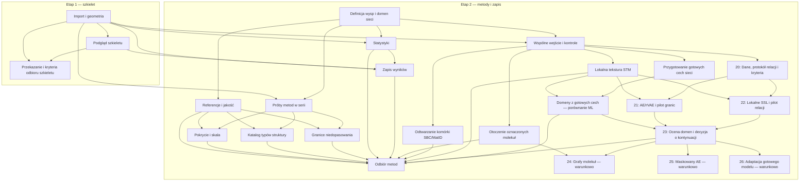

# Rejestr decyzji STM Domains

[Mapa decyzji etapu 1](../map.md) jest zakończona. Następny krok aplikacyjny to
[budowa i odbiór szkieletu](../implementation/README.md), nie kolejna decyzja.
Zadania wykonawcze są oddzielone od poniższego rejestru pytań.
[Etap 2: metody i zapis wyników](../map-methods-and-save.md) rozpoczyna się po
implementacji i odbiorze szkieletu. Otwarte decyzje etapu 2 nie blokują etapu 1.
Statusy i zależności przechowujemy w ticketach; indeks poniżej grupuje je według map.

**Aktualny stan 2026-10-31:** [19](19-frozen-feature-domains.md) ma status
`resolved` — użytkownik zakończył serię analiz, bez przyjęcia detektora.
[Podsumowanie ustaleń](19-frozen-feature-domains.md) zachowuje osiągnięcia
cząstkowe i ograniczenia. Przygotowanie [20](20-self-supervised-training-preparation.md)
pozostaje `open`, nierozpoczęte; jakość 04 i odbiór 13 pozostają otwarte.
Wcześniejsze statusy w poniższej chronologii opisują historyczne decyzje.

Tego samego dnia użytkownik zatwierdził
[usprawnienia planu](../research-domain-plan-improvements.md): wpisano je
do 20–23. Pilot relacji i granic należy do 21/22, bez osobnego ticketu 20a.
Obowiązuje kolejność **20 → 21 i 22 → 23**, z 24–26 wyłącznie po wyborze
rozszerzenia. Aktualizacja planu nie oznacza rozpoczęcia tych zadań.

Na bezpośrednie polecenie użytkownika z 2026-10-19 wcześniej podejmujemy
[definicje wyspy, typu i domeny sieci](02-order-types-and-domains.md) oraz
[pilotaż porównania metod](05-stable-types-across-frames.md). Pilotaż zakończono
wskazaniem luk; na polecenie użytkownika utworzono dalsze pytania o pokrycie,
typy, granice domen i odbiór metod. To jawne wyjątki dla wskazanych zadań,
bez deklaracji gotowego szkieletu lub zwalidowanego algorytmu.
Następnie na bezpośrednie polecenie użytkownika uzgodniono także
[definicje statystyk klatek](06-frame-statistics.md). Odbiór metod i zapis
wyników korzystają z tych definicji; sama decyzja nie implementuje statystyk.

W pierwszym etapie rozstrzygnięto również
[podgląd szkieletu](07-browsing-and-comparison.md): po reakcji na prototyp
wybrano jeden obraz i pasek miniatur. Zamknięto też
[przekazanie do implementacji i kryteria odbioru](09-implementation-handoff.md).
Wszystkie decyzje pierwszej mapy są rozstrzygnięte; trzy zadania wykonawcze
pozostają `todo`, a odbiór programu wymaga rzeczywistych danych i GUI.

Na kolejne polecenie użytkownika rozstrzygnięto
[kontrakt zapisu i eksportu](08-save-and-export.md) przed odbiorem metod:
samowystarczalny zapis z MPP, opcjonalnym wynikiem oraz CSV/PNG. Zależność
odwrócono: odbiór metod sprawdzi realizację tego kontraktu na wynikach prób.
Nie oznacza to implementacji zapisu ani odbioru metod.

2026-10-21 na bezpośrednie polecenie użytkownika wykonano
[wstępne porównanie pokrycia i skali](10-coverage-and-scale.md). Wynik omówiono,
po czym wykonano próbę na dostarczonych częściowych referencjach. Po omówieniu
wyników krok 10 ma status `resolved` jako zakończony eksperyment. Nie wybrano
metody; pełna ocena pokrycia pozostaje w zakresie odbioru metod i protokołu jakości.
Krok 10 nie zależy od kroku 11. Dotychczasowy graf zależności pozostaje bez zmian.

Następnie na polecenie użytkownika wykonano [próbę katalogu typów](11-structural-type-catalogue.md).
Krok 11 ma status `resolved` jako ukończony eksperyment. [Raport](../structural-type-catalogue-trial.md)
wykazuje poprawę prostych kontroli po dodaniu rozstawu i różnic odległości,
ale brak stabilnego katalogu TTMAPP. Użytkownik wyjaśnił znaczenie kolorów
jako głównie różnych orientacji tej samej sieci; nie zatwierdzono metody.
Dalsze luki pozostają w odbiorze 13, a granice niedopasowania w osobnym kroku 12.

Na kolejne polecenie wykonano [próbę granic niedopasowania](12-phase-boundaries.md).
Krok 12 ma status `resolved` jako zakończony eksperyment. [Raport](../phase-boundaries-trial.md)
wskazuje przydatność niedopasowania wektorów centrów na kontrolach i ograniczenia
fazy obrazu, dostępności sieci oraz interpretacji rozłączonych grafów.
Nie wybrano metody produkcyjnej ani nie policzono dokładności granic TTMAPP.
Próby 10–12 są zakończone; odbiór metod 13 i protokół jakości 04 nadal otwarte.

Po przeglądzie MolTrack i literatury STM/AFM użytkownik polecił wpisać
[kolejne próby samodzielnego znajdowania domen](#próby-samodzielnego-znajdowania-domen)
do istniejącej mapy. Następny krok badawczy to przygotowanie wspólnego
wejścia i kontroli, potem porównania kandydatów. Po przeglądzie ML dodano
przygotowanie gotowych cech i ich porównanie z klasyczną teksturą, bez
własnego treningu sieci. Analizujemy całe klatki;
ramki służą wyłącznie późniejszej ocenie. Nie zakładamy istnienia domen
ani ich liczby i nie uczymy klas z ręcznie zaznaczonych przykładów.
Nowe tickety są otwarte, próby nie zostały uruchomione.

Po dopuszczeniu treningu bez etykiet i ostatnim przeglądzie użytkownik
polecił dodać [zadania 20–26](#trening-bez-etykiet-domen). Najpierw
przygotowujemy protokół, następnie porównujemy AE/rVAE i lokalne SSL.
Decyzja po tych próbach wybierze ewentualne rozszerzenia. Gotowe modele
z kroków 18–19 zachowują niezmienione wagi jako punkt odniesienia.

## Wayfinding operations

Stan 2026-10-23: [przygotowanie 14](14-unsupervised-input-and-controls.md)
zakończone. [Raport](../unsupervised-input-preparation.md) i
[protokół wejścia/wyników](../experiment-input-protocol.md) opisują gotowy
zestaw. Następnie wykonano [pierwszą próbę 15](../local-neighborhood-domains-trial.md).
Issue 15 początkowo pozostawało `claimed`: użytkownik wybrał dalsze
rozwinięcie próby, bez przejścia do 16. Prosty opis/SOAP nie dały gotowej
metody. Następnie [zbadano kryterium powtarzalności](../recurrence-criterion-trial.md):
38 konfiguracji, 204 próbki, przypisanie w referencjach 31.0% → 62.5%,
lecz nadal scalenia i odmowy przy łączeniu zgodnych orientacyjnie składowych.
Na następne polecenie wykonano [orientację i łączenie](../orientation-and-joining-trial.md):
31 wariantów, 228 próbek. Komórka ze zgodnością ze startem poprawia braki
i część TTMAPP, lecz pomija RED/YELLOW i scala zaburzoną granicę przesunięcia.
Użytkownik polecił przejść do 16; 15 zakończono jako porównanie, bez wyboru
algorytmu produkcyjnego. [Próba SBC/MatID](../sbc-matid-domains-trial.md)
jest wykonana na 228 próbkach. Daje poprawę braków, deformacji i trudnej
granicy, ale fałszywy porządek, mała różnica orientacji i niestabilność
ziarna wykluczają przyjęcie konfiguracji. 16 jest `resolved`: użytkownik zatwierdził porównanie
i wybrał przejście do 17 — tekstury. [Próba 17](../image-texture-domains-trial.md)
jest wykonana i zatwierdzona jako porównanie: `resolved`, bez przyjęcia
metody. Wariant obrazowy jest niezależny od anotacji, ale na TTMAPP ma
0.3–5.8% przypisań i pomija RED/YELLOW. Cechy zachowano do porównań ML.

Stan 2026-10-26: [przygotowanie 18](../frozen-feature-preparation.md) jest
`resolved`. FCN–ResNet101 i DINOv2 ViT-S/14 działają z niezmienionymi
wagami; cechy siatki pozostają identyczne bez centrów i niezależne od
referencji. Gotowe cechy obejmują pilotaż 12 obrazów, bez detekcji domen.
[Porównanie 19](../frozen-feature-domains-trial.md) wykonano: FCN/DINO nie
poprawiły wyniku; 0–5.1% przypisań we wnętrzach TTMAPP i błędy kontroli.
Użytkownik wybrał dalsze omówienie/rozwinięcie, dlatego 19 pozostaje
`claimed`; nie wybrano metody do programu. Następnie wykonano
[diagnozę cech/PCA/epsilon](../feature-separation-trial.md): cechy
zachowują rozróżnienie obrotu/rozstawu na kontrolach, ale 32 warianty
nie naprawiają podziału TTMAPP. Lokalny podgląd `.scratch/feature-separation/`;
status 19 nadal `claimed`, do omówienia kolejnego wyniku.
Wykonano też [lokalny graf i przesunięcie siatki](../local-feature-graph-trial.md):
32 warianty, mniej części scaleń kosztem nadmiernych podziałów jednej sieci,
zależność od położenia siatki i utrzymane ograniczenie przypisań przez ACF.
Żaden wariant nie spełnia wszystkich warunków; `.scratch/local-feature-graph/`.
Wykonano następnie [skalę i podparcie ACF](../acf-scale-support-trial.md)
przy niezmienionych cechach/podziałach: większe okno odzyskuje fragmenty,
ale zaciera przerwy; 0/512 nowych konfiguracji detektora spełnia komplet
warunków. Później wykonano ablację drugiego kierunku oraz zgodność
przesunięć i lokalny sygnał. Na ostatnie polecenie przeprowadzono
[audyt odmów](../vector-refusal-audit.md): wektory obrazu i centrów w tych
samych otoczeniach, 78 znanych obrazów. Podmiana daje tylko 17 pojedynczych
miejsc i nadal 0/1678 przypisań TTMAPP; kryterium zależy także od bazy sieci.
**19 nadal `claimed`; użytkownik wybrał pozostanie przy 19, a 20 odłożył.**
[Rodzinę przesunięć](../translation-family-trial.md) zbadano następnie
na 165 obrazach, w tym 42 nowych. Oceny równoważnych baz są identyczne,
ale agregacje obrazu nadal dają zero przypisań TTMAPP. Zgodność centrów
daje do 17.6%, tylko BLACK, i błędy granic/niezależnych rzędów.
Wykonano [tolerancję pozycji i test fazy](../tolerant-fit-phase-trial.md):
210 obrazów, 84 warianty. Częściowa poprawa kontroli jitteru/braków, lecz
pozostawione mostki nadal scalają granicę, a TTMAPP osiąga najwyżej 7.4%.
Następnie wykonano [rozłączne modele i podparcie materiału](../disjoint-models-material-trial.md):
261 obrazów, 96 wariantów. Prosta granica rozdzielona przy centrach;
sygnał rozróżnia szeroką przerwę i same braki oznaczeń. TTMAPP nadal bez
kwalifikowanych porównań; granice ukośne i szum pozostają problemem.
Wykonano [diagnostykę jakości](../fit-quality-diagnosis.md): 97 obrazów,
54 nowe syntetyki, 68184 oceny. Ujawniono błędny okres proponowany po
podziale oraz za mało niezależnych rzędów. Nowa ocena tolerancji/liczebności
nie daje ogólnej poprawy. Następnie wykonano [próbę kandydatów baz i nowych powtórzeń](../basis-candidates-trial.md):
97 obrazów, 54 nowe syntetyki, 15152 otoczenia. Dzielniki odzyskują właściwy
okres w 9/9 celowanych kontrolach R64, ale na TTMAPP przy wspólnym progu
nie ma poprawy. Wykonano kolejną [próbę motywu i kompletności](../motif-completeness-trial.md):
103 obrazy, 60 nowych kontroli. Oddzielna ocena pozycji poprawia odporność
na braki, motyw poprawia geometrię par, lecz dodaje fałszywe akceptacje rzędów.
TTMAPP bez przewagi motywu: te same 7/5 lokalnych akceptacji pierścienia/nowych
rzędów co przy jednej pozycji. Do omówienia zachowanie składników jako punktu
odniesienia i przygotowanie treningu; nie wybrano metody.
Po omówieniu użytkownik zakończył serię: **19 `resolved`**, bez wyboru metody.
20 pozostaje otwarte i nierozpoczęte; odbiór 13 i jakość 04 otwarte.

Lokalny tracker Markdown znajduje się w wersjonowanym `docs/stmdomains/`, zgodnie
z instrukcjami repozytorium. Nie wymaga zewnętrznego trackera.

- **Mapa:** osobny plik z etykietą `wayfinder:map`. Domyślnie aktywna jest
  `../map.md`; jej pytania są już rozstrzygnięte i trwa przekazanie do zadań
  wykonawczych. Do zwykłego toku drugiej mapy przechodzimy po odbiorze szkieletu.
  Samo zamknięcie decyzji nie jest odbiorem programu. Dla kontynuowanego
  na polecenie użytkownika badania metod aktywny jest cykl nowych prób
  w drugiej mapie; nie wymaga odbioru aplikacji.
- **Pytanie:** jeden plik `NN-nazwa.md`. `ID` identyfikuje go w całym rejestrze,
  `Parent` wskazuje mapę, a tytuł służy do nazywania w rozmowie i linkach.
  Zachowujemy dotychczasowe ID i ścieżki również po zmianie zakresu.
- **Typ:** `Type` i odpowiadająca mu etykieta `wayfinder:<type>`; bez etykiet
  implementacyjnych. `Mode: HITL` wymaga rozmowy z użytkownikiem.
- **Status:** `open`, `claimed`, `resolved`; dodatkowo `closed` dla pytania
  usuniętego z zakresu. Zamknięcie zakresowe opisujemy pod `Scope disposition`;
  nie oznacza naukowego rozstrzygnięcia ani spełnienia zależności.
- **Frontier:** wybieramy wyłącznie dzieci aktywnej mapy z `Status: open`,
  pustym `Assignee` i wszystkimi zależnościami `resolved`. Pierwszeństwo ma
  aktualny zakres wskazany w Notes mapy, a w jego obrębie kolejność numerów
  plików. Pytanie innej mapy nie trafia do tej kolejki. W cyklu nowych prób
  pierwsze jest przygotowanie wspólnego wejścia; otwarty protokół pełnej
  jakości pozostaje osobnym pytaniem do odbioru, nie blokadą tych prób.
  Dla ticketów z sekcją `Warunek podjęcia` trzeba dodatkowo sprawdzić
  zapisany wybór w kroku 23. Niewybrane rozszerzenia 24–26 nie trafiają
  do frontier, nawet gdy wszystkie ich zależności są `resolved`.
- **Zależności:** `Blocked by` wskazuje istniejące ID, także innej mapy;
  `Dependencies` zawiera odpowiadające nazwane linki. Zmiana zależności wymaga
  aktualizacji diagramu. Otwarte pytanie nie może zależeć od zakresowo
  zamkniętego pytania; taką zależność trzeba usunąć lub zastąpić.
- **Claim:** przed pracą ustaw prowadzącego w `Assignee` i `Status: claimed`.
  Pytania przypisanego innej sesji nie podejmujemy równolegle.
- **Resolve:** dopisz datowany wynik pod `Answer`, ustaw `Status: resolved`
  i dodaj nazwany link z krótkim wynikiem do Decisions so far właściwej mapy.
  Zamknięcie zakresowe trafia do Out of scope, nie do Decisions so far.
- **Nowe pytania:** najpierw utwórz pliki, potem wpisz realne ID i zależności.
  Dopiero wtedy usuń odpowiadający obszar z Not yet specified mapy.
- **Praca:** grilling korzysta z `grilling` i `domain-modeling`, prototype
  z `prototype`, research z `wayfinder` i `research`. W sesji rozstrzygamy
  najwyżej jedno pytanie, z wyjątkiem research. Aktualizacja zakresu na polecenie
  użytkownika nie potwierdza automatycznie odpowiedzi technicznych.

Metadane do wyboru kolejnego pytania:

```bash
rg -n '^(# |Status:|Assignee:|Parent:|Blocked by:)' docs/stmdomains/issues/[0-9][0-9]-*.md
```

## Etap 1 — szkielet

| Pytanie | Typ |
| --- | --- |
| [Jak zapis wejściowy odtwarza obrazy, oznaczenia i rejestrację?](01-import-and-geometry.md) | grilling |
| [Jak przeglądać obrazy i oznaczenia w szkielecie?](07-browsing-and-comparison.md) | prototype |
| [Jak przekazać szkielet do implementacji i go odebrać?](09-implementation-handoff.md) | grilling |

## Etap 2 — po odbiorze szkieletu

| Pytanie | Typ |
| --- | --- |
| [Jak definiujemy wyspę, typ uporządkowania i domenę sieci?](02-order-types-and-domains.md) | grilling |
| [Jakie referencje i kryteria potwierdzą wiarygodność analizy?](04-reference-and-quality.md) | grilling |
| [Jak porównać metody wykrywania wysp i domen w serii?](05-stable-types-across-frames.md) | prototype |
| [Jak dokładnie liczymy ilości i udziały na każdej klatce?](06-frame-statistics.md) | grilling |
| [Co zapisujemy i eksportujemy po próbach metod?](08-save-and-export.md) | grilling |
| [Jak wyznaczać pokrycie bez mylenia luk oznaczeń z podłożem?](10-coverage-and-scale.md) | prototype |
| [Jak rozpoznawać typy przy obrocie, zmianie rozstawu i rzadkich wzorach?](11-structural-type-catalogue.md) | prototype |
| [Jak rozdzielać domeny o tym samym typie i orientacji?](12-phase-boundaries.md) | prototype |
| [Które metody i warunki odmowy wyniku przyjmujemy po próbach?](13-method-acceptance.md) | grilling |

### Próby samodzielnego znajdowania domen

Kontynuacja badań na obecnych danych, dopuszczona przed odbiorem szkieletu.
Zadanie przygotowania nie zależy od zamknięcia pełnego protokołu jakości;
ten nadal warunkuje odbiór metod. Statusy znajdują się w ticketach.

| Pytanie/zadanie | Typ | Kolejność |
| --- | --- | --- |
| [Jak przygotować wspólne wejście i kontrole bez narzucania domen?](14-unsupervised-input-and-controls.md) | task / AFK | Pierwszy krok; E0 |
| [Czy otoczenie zaznaczonych molekuł pozwala samodzielnie znaleźć domeny?](15-local-neighborhood-domains.md) | prototype / HITL | `resolved`: trzy próby; użytkownik polecił porównanie 16, bez przyjęcia metody, E1 |
| [Czy SBC/MatID odtwarza domeny z niepełnych centrów molekuł?](16-sbc-matid-domains.md) | prototype / HITL | `resolved`: porównanie zachowane, użytkownik wybrał przejście do 17, E2 |
| [Czy lokalna tekstura STM pozwala znaleźć domeny bez przykładów?](17-image-texture-domains.md) | prototype / HITL | `resolved`: widmo/EWT zachowane do porównań ML, bez przyjęcia metody; E3 |
| [Jak przygotować cechy gotowych sieci bez treningu na naszych danych?](18-frozen-feature-preparation.md) | task / AFK | `resolved`: oba ekstraktory, cache, geometria i powtarzalność sprawdzone |
| [Czy gotowe cechy sieci pomagają odkrywać domeny bez przykładów?](19-frozen-feature-domains.md) | prototype / HITL | `resolved`: seria porównań i diagnostyki zakończona; zachowane wyniki cząstkowe, brak przyjętej metody TTMAPP; 20 otwarte, nierozpoczęte |

Próby geometrii, SBC/MatID i klasycznej tekstury są niezależne. Porównanie
ML korzysta z wyniku tekstury jako punktu odniesienia, również gdy jest
negatywny. DINOv3 jest opcjonalny; nie warunkuje zakończenia prób.
Ich udokumentowane wyniki, także negatywne, zasilają istniejący
[odbiór metod](13-method-acceptance.md). Zamkniętych badań pokrycia, katalogu
typów i granic nie otwieramy ponownie. Dawny
[plan eksperymentów](../unsupervised-domain-experiments.md) prowadzi teraz
do ticketów; zakres i warunki zakończenia utrzymujemy w ich treści.

### Trening bez etykiet domen

Rozszerzenie na podstawie [badania treningu](../research-self-supervised-domain-learning.md),
z [usprawnieniami przyjętymi 2026-10-31](../research-domain-plan-improvements.md).
Każda próba używa pełnych pól pomiarowych; ręczne ramki służą ocenie,
bez dostarczania klas ani liczby domen. Statusy i zależności są w ticketach.
W [20](20-self-supervised-training-preparation.md#wspólny-protokół-relacji-i-podziału)
ustalamy budżet i wspólny protokół małego porównania 2 × 2: zachowane/nowe
cechy oraz dotychczasowy/nowy sposób podziału. Pilot w 21/22 ocenia lokalne
relacje przez granice, pełne propozycje domen i odmowy; nie powtarza serii 19.

| Pytanie/zadanie | Typ | Kolejność |
| --- | --- | --- |
| [20 — Jak przygotować odtwarzalny trening bez etykiet domen?](20-self-supervised-training-preparation.md) | task / AFK | Po 14; dane, GPU, protokół relacji, budżet i kryteria |
| [21 — Czy AE i rVAE uczą się cech przydatnych do odkrywania domen?](21-autoencoder-domains.md) | prototype / HITL | Po 17 i 20; AE/rVAE oraz wspólny pilot granic i podziału |
| [22 — Czy lokalne uczenie podobieństwa poprawia wykrywanie domen?](22-local-self-supervised-domains.md) | prototype / HITL | Po 17 i 20; lokalne SSL z pilotem relacji, niezależnie od 21 |
| [23 — Czy trening daje poprawę i które rozszerzenie warto wykonać?](23-training-comparison-and-next-step.md) | grilling / HITL | Po 19, 21 i 22; ocena cech, relacji, podziału i odmów; decyzja o kontynuacji |
| [24 — Czy uczenie grafu otoczeń molekuł poprawia wykrywanie domen?](24-graph-self-supervised-domains.md) | prototype / HITL | Warunkowo: wybrane w 23, po wyniku 15 |
| [25 — Czy maskowane odtwarzanie obrazu uczy relacji potrzebnych do domen?](25-masked-autoencoder-domains.md) | prototype / HITL | Warunkowo: wybrane w 23 |
| [26 — Czy dalsze uczenie gotowego modelu na STM poprawia odkrywanie domen?](26-pretrained-self-supervised-adaptation.md) | prototype / HITL | Warunkowo: wybrane w 23, z zachowanym modelem odniesienia |

18 i 19 są zakończone; najbliższe zadanie to przygotowanie 20.
Próby 21 i 22 wymagają wyniku tekstury, również negatywnego, i wspólnego
przygotowania 20; żadna nie wymaga powodzenia drugiej. Ich zestawienie
23 korzysta również z zachowanych wyników 19. Wspólny pilot nie dodaje
nowej zależności ani oddzielnego zadania przygotowawczego.
Odbiór 13 czeka na 23, lecz nie na wszystkie warunkowe rodziny modeli.
Jeśli w 23 wybierzemy rozszerzenie, dodajemy je do zależności 13 i diagramu.
Brak wyboru nie oznacza wykonania lub nieskuteczności tego rozszerzenia.

Pierwsze próby planujemy na RTX 5090 32 GB VRAM / 128 GB RAM. Użycie
drugiego komputera z 96 GB VRAM lub Colab wynika z pomiaru i hipotezy
wybranej w 23. Dostępność tych zasobów nie jest warunkiem zakończenia
podstawowego porównania. Żadnego treningu nie uruchomiono przez dodanie mapy.

## Odłożone poza oba etapy

[Jak mierzyć orientację molekuły i oznaczać wynik niepewny?](03-molecular-orientation.md)
zamknięto zakresowo. Zachowano treść i materiały, bez wyboru metody.

## Zależności decyzji

Strzałki pokazują warunki wstępne pytań, nie kolejność implementacji ani status.
Zwykły tok etapu 2 wymaga odebranego szkieletu, zgodnie z mapami; opisany
wyżej cykl badań można prowadzić wcześniej na polecenie użytkownika.
Wyjątek dla zakończonego pilotażu nie zamyka referencji jakości. Ich zależność
przeniesiono do dalszych prób i odbioru metod. Na późniejsze polecenie użytkownika
kontrakt zapisu ustalono wcześniej; teraz odbiór metod zależy od tego kontraktu
i weryfikuje jego realizację.



Krawędzie do 24–26 pokazują warunki wstępne. Dodatkowo wymagany jest
wybór rozszerzenia w 23; dopiero wtedy dodajemy jego krawędź do odbioru 13.
