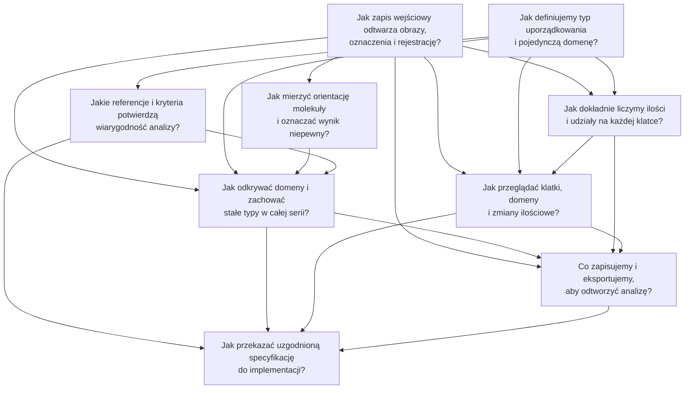

# Rejestr decyzji STM Domains

Tracker lokalny mapy
[STM Domains — specyfikacja analizy typów uporządkowania w serii](../map.md).
Pliki i ich metadane są źródłem statusu; poniższy indeks nie przechowuje odpowiedzi.

## Wayfinding operations

Stosujemy lokalny tracker Markdown, z katalogiem `docs/stmdomains/` zamiast
domyślnego `.scratch/`: instrukcje repozytorium wymagają wersjonowania map i pytań
w katalogu aplikacji. Nie jest potrzebny zewnętrzny tracker ani publikacja issues.

- **Mapa:** `../map.md`, z etykietą `wayfinder:map`.
- **Pytanie:** jeden plik `NN-nazwa.md`, jego `ID` jest lokalną tożsamością.
  Tytuł jest nazwą używaną w rozmowie i odnośnikach. `Parent` wskazuje mapę.
- **Typ:** `Type` i odpowiadająca mu etykieta `wayfinder:<type>`; bez etykiet
  triage implementacji. `Mode: HITL` wymaga rozmowy z użytkownikiem.
- **Status:** `open`, `claimed`, `resolved`. Otwarte pytanie bez `Assignee` jest
  niepodjęte. `Blocked by` podaje istniejące lokalne ID; sekcja Dependencies
  przedstawia te same zależności nazwami i linkami.
- **Frontier:** pytania otwarte, bez przypisania, których wszystkie zależności
  mają status `resolved`. Pierwszeństwo ma kolejność numerów plików.
- **Claim:** przed pracą zapisz prowadzącego w `Assignee` i ustaw `Status: claimed`.
  Nie podejmuj równocześnie pytania przypisanego innej sesji.
- **Resolve:** dopisz wynik jako osobny komentarz pod `## Answer`, z datą
  i odnośnikami do materiałów; nie zastępuj nim pytania. Ustaw `Status: resolved`
  i dodaj jednowierszowy odnośnik z nazwą do Decisions so far mapy.
- **Nowe pytania:** najpierw utwórz pliki, potem wpisz istniejące ID w zależnościach
  i dodaj odnośniki. Dopiero wtedy usuń odpowiadający im obszar niewiedzy z mapy.
- **Praca:** typ grilling używa `grilling` i `domain-modeling`; prototype używa
  `prototype`. Pytania research uruchamiają procedurę `wayfinder` i `research`.
  W jednej sesji rozstrzygamy najwyżej jedno pytanie, z wyjątkiem research.
  Samo wytyczanie mapy nie rozstrzyga żadnego pytania.

Aktualny stan można odczytać bez otwierania wszystkich treści:

```bash
rg -n '^(# |Status:|Assignee:|Blocked by:)' docs/stmdomains/issues/[0-9][0-9]-*.md
```

Następnie wybierz pierwsze pytanie spełniające regułę Frontier. Diagram pokazuje
zależności, a nie statusy; strzałka prowadzi od warunku wstępnego do pytania
od niego zależnego. Zmiana zależności wymaga aktualizacji diagramu.

## Indeks

| Pytanie | Typ |
| --- | --- |
| [Jak zapis wejściowy odtwarza obrazy, oznaczenia i rejestrację?](01-import-and-geometry.md) | grilling |
| [Jak definiujemy typ uporządkowania i pojedynczą domenę?](02-order-types-and-domains.md) | grilling |
| [Jak mierzyć orientację molekuły i oznaczać wynik niepewny?](03-molecular-orientation.md) | prototype |
| [Jakie referencje i kryteria potwierdzą wiarygodność analizy?](04-reference-and-quality.md) | grilling |
| [Jak odkrywać domeny i zachować stałe typy w całej serii?](05-stable-types-across-frames.md) | prototype |
| [Jak dokładnie liczymy ilości i udziały na każdej klatce?](06-frame-statistics.md) | grilling |
| [Jak przeglądać klatki, domeny i zmiany ilościowe?](07-browsing-and-comparison.md) | prototype |
| [Co zapisujemy i eksportujemy, aby odtworzyć analizę?](08-save-and-export.md) | grilling |
| [Jak przekazać uzgodnioną specyfikację do implementacji?](09-implementation-handoff.md) | grilling |


